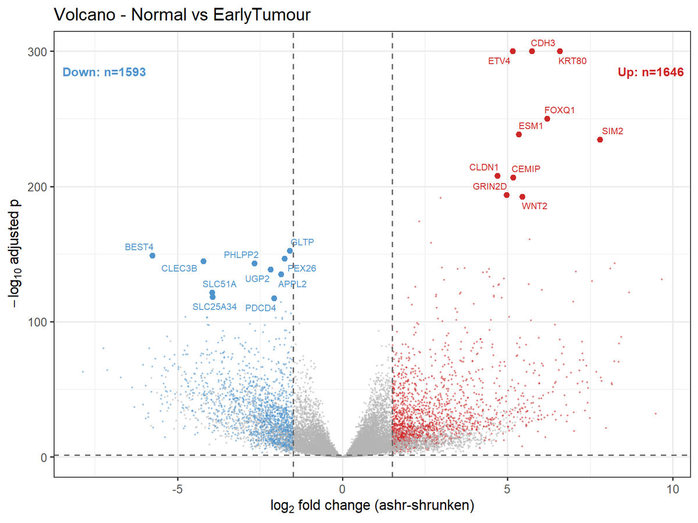
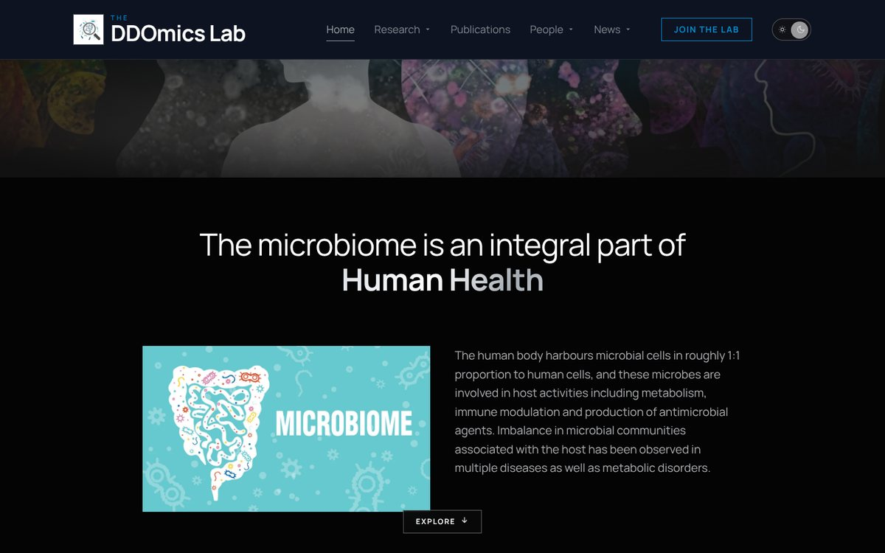

<div align="center">

<a href="https://www.nccs.res.in/"></a>
<a href="mailto:Suyashjadhav710@gmail.com"></a>


<sub>

**[About](#about)** &nbsp;·&nbsp; **[Research](#research)** &nbsp;·&nbsp; **[Finished work](#projects)** &nbsp;·&nbsp; **[Toolbox](#toolbox)** &nbsp;·&nbsp; **[Activity](#activity)** &nbsp;·&nbsp; **[Contact](#connect)**

</sub>

</div>

<a id="about"></a>


I'm a **microbiologist who learned to code because the questions got bigger than the spreadsheet.** I'm doing my PhD at the **DDOmics Lab, National Centre for Cell Science (NCCS), Pune**. I study how microbial communities shape human health, and I build the software that makes that work repeatable.

- 🔭 &nbsp;**Working on:** gut microbiome and microbial genomics, kept in the lab notebook until it's finished
- 🧪 &nbsp;**Shipped:** [SangerCap](#projects), from Sanger traces to a defensible microbial ID in one command
- 🌱 &nbsp;**Learning:** metabolic modelling, better ML validation, and one LeetCode problem at a time
- 🤝 &nbsp;**Open to:** microbiome collaborations and research software for labs
- ⚡ &nbsp;**Fun fact:** I culture the bugs *and* write the pipelines, so I wear gloves and a terminal

<a id="research"></a>


<table>
<tr>
<td align="center" width="25%"><h3>🦠</h3><b>Gut microbiome</b><br/><sub>Community structure, diet and host factors</sub></td>
<td align="center" width="25%"><h3>🧬</h3><b>Microbial genomics</b><br/><sub>Isolates, identification and comparative genomics</sub></td>
<td align="center" width="25%"><h3>🎗️</h3><b>Cancer multi-omics</b><br/><sub>Transcriptomics, chromatin and survival in CRC</sub></td>
<td align="center" width="25%"><h3>🛠️</h3><b>Research software</b><br/><sub>Reproducible pipelines and tools for wet labs</sub></td>
</tr>
</table>

<a id="projects"></a>


> [!NOTE]
> Source code for these projects is private for now. Ask me for access or a walkthrough.

<table>
<tr>
<td width="46%" valign="middle"></td>
<td width="54%" valign="top">

### 🧪 SangerCap
  

Identifies microbial isolates from `.ab1` Sanger traces in one command. It trims with TraceTuner, assembles with CAP3, identifies with BLAST plus global alignment, then calls a taxonomic rank. Every sample gets a review flag for mixed cultures, species ties or partial matches. It runs as a Windows/macOS desktop app or a CLI, and every run writes a manifest with tool versions and checksums.

<sub>**Why v2 exists:** v1 was a FastAPI + Celery + Redis + Docker web app that took eight steps to install. I rebuilt it as one installable program, because the best architecture is the one labmates can actually install.</sub>

</td>
</tr>
<tr>
<td width="46%" valign="middle"></td>
<td width="54%" valign="top">

### 🎗️ CRC Multi-Omics Biomarker Discovery
  

Ranks colorectal cancer biomarkers by how much evidence converges on them. It combines TCGA RNA-seq, ENCODE promoter accessibility, adjusted survival models, a bootstrapped Bayesian network, patient-level LASSO and 1000 Genomes South Asian vs European allele frequencies.

**First full run:** 557 patients · 3,239 genes changed between normal colon and stage I/II tumours · a 15-gene candidate panel · stage classifier AUC 0.70.

<sub>**Reported honestly:** the stage signal mostly reflected immune and stromal composition, and no candidate survived multiple-testing correction for survival.</sub>

</td>
</tr>
<tr>
<td width="46%" valign="middle"></td>
<td width="54%" valign="top">

### 🌐 DDOmics Lab Website
  

The site for Dr. Dhiraj Dhotre's lab at NCCS covers 24 people, 85 publications, research, facilities and news. All content lives in plain `.tsv` and `.md` files that labmates edit on GitHub without code. Every change is validated, type-checked and built in CI, and all 28 pages are prerendered for GitHub Pages.

</td>
</tr>
</table>

<a id="toolbox"></a>


| Area | Tools |
|:--|:--|
| **Languages** |  |
| **Omics & stats** |      |
| **ML & data** |   |
| **Workflows & infra** |     |
| **Web** |  |
| **Wet lab** | Culturing and isolation · DNA extraction · Sanger and 16S sequencing · Microbial identification |

<a id="activity"></a>


<!-- Redrawn daily from your contribution calendar by .github/workflows/contrib-graph.yml -->


```diff
+ 2026-03-15   SangerCap 1.0.0         web app: FastAPI · Celery · Redis · React · Docker
+ 2026-08      DDOmics Lab website     content editable without code, validated in CI
+ 2026-10-02   SangerCap 2.0.0         rebuilt as a desktop app and CLI
+ 2026-10-05   SangerCap 2.0.2         scheduled runs on the lab server
+ 2026-10-15   CRC Multi-Omics 2.0.0   first complete run and results report
```

#### How I work

| 📜 Scope first | 🔁 Reproducible | 📖 Documented | 🧑‍🔬 Usable |
|:--|:--|:--|:--|
| Each project says what it can and cannot claim. | Config files, not magic numbers. Run manifests with checksums. | Why each method was chosen and how to run it. | Installers, review flags, no-code editing. |

<a id="connect"></a>


<div align="center">

I'm happy to talk about microbiomes, Sanger data, or a tool your lab keeps wishing it had.

<a href="mailto:Suyashjadhav710@gmail.com"></a>


</div>
