 


Hi, I'm Suyash. I'm a bioinformatician and a Ph.D. scholar in the DDOmics Lab at the National Centre for Cell Science, Pune, where I build computational tools to read and make sense of microbiome sequencing data.

I started out with a B.Sc. in Biotechnology in Nashik, then did my M.Sc. at the Bioinformatics Centre, Savitribai Phule Pune University, which is where I moved fully into bioinformatics. I joined NCCS in August 2026 on a CSIR-UGC NET fellowship.

When I'm away from the screen, I'm usually watching Formula 1, which is where the start lights up there come from. 



 

For my dissertation I worked with gut microbiome data from 3,020 people belonging to 17 communities across India, both tribal and non-tribal, along with a food questionnaire that most of them filled in. The question was easy to ask: do Indian guts fall into a few recurring community types, and can you tell which one a person has from what they eat?

*Prevotella* turned out to dominate almost everyone. The model settled on five enterotypes, and which one people carried lined up with their region, how urban their lives were and their diet. I also built a small Shiny app where you answer 34 questions about your diet and it guesses your enterotype. It does better than chance, though honestly not by a lot.

When I went back to the data recently, I found that one of those five groups was mostly samples from low-depth sequencing runs, so it was a batch effect rather than biology. I'm now redoing the analysis with a cleaner pipeline that accounts for sequencing runs, picks the number of enterotypes by a rule fixed in advance, and tests the questionnaire on states it has never seen.


I wanted to know which genes separate normal colon tissue from early colorectal cancer if you don't rely on differential expression alone. So I took TCGA RNA-seq data from 557 patients and layered chromatin accessibility from ENCODE, survival models, a Bayesian network and South Asian vs European allele frequencies from 1000 Genomes on top. Then I ranked genes by how much of that evidence agreed.

It gave me a shortlist of 15 genes. It also showed that most of what looked like a difference between early and late stage tumours was really a difference in the immune and stromal cells in the samples, and none of the 15 held up for survival once I corrected for multiple testing. Not what I was hoping for, but I'd rather know.


I built the DDOmics Lab website so that nobody would need me to keep it updated. People, publications, news and everything else live in simple table files that anyone in the lab can edit straight on GitHub, and every change gets checked automatically before it goes up.

 

Most of what I'm working on right now is still unpublished and lives in private repos, so this graph is the only bit of it you can see for now. It redraws itself every day, the car does a lap underneath it, and my busiest day gets the purple fastest-lap tag.




I mostly write R and Python, with a fair amount of Bash holding things together.



 

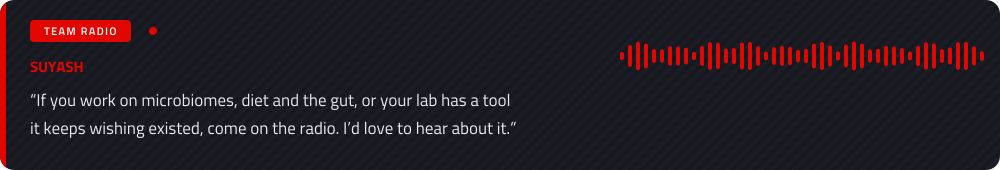

Email me at **Suyashjadhav710@gmail.com**, or find me on [LinkedIn](https://www.linkedin.com/in/suyash-jadhav-bioinformatician/), [ORCID](https://orcid.org/0009-0000-1043-7044) and [X](https://x.com/SuyashJ0710).

