 

Hi, I'm Suyash. I'm doing my PhD at the National Centre for Cell Science in Pune, in the DDOmics Lab, where I work on microbes and what they do inside us.

I'm a microbiologist first. I got into coding because the sequencing data kept piling up faster than I could deal with it in Excel, and at some point writing a script became quicker than doing things by hand. Now I spend about as much time in a terminal as I do at the bench, and I enjoy both.

Most of what I build is for the people in my own lab, so I care a lot about whether a tool is easy to install and whether its output can be trusted without me standing next to it.

 

 

**SangerCap**

Our lab sends out Sanger plates all the time, and every isolate on them needs a name you can actually defend. Doing that by hand meant trimming reads, assembling forward and reverse, running BLAST and then squinting at the hits. SangerCap does the whole thing from a folder of `.ab1` files. It also tells you which samples need a second look, like mixed cultures, ties between two species, or reads that refused to assemble.

The first version was a web app built on FastAPI, Celery, Redis and Docker. It worked, but installing it took eight steps, which is silly for a tool one person uses at a time. So in September I rewrote it as a normal desktop app and command-line tool. It's on version 2.0.2 now and runs on Windows, macOS and Linux.

**CRC multi-omics biomarker discovery**

I wanted to know which genes separate normal colon tissue from early colorectal cancer if you don't rely on differential expression alone. So I took TCGA RNA-seq data from 557 patients and layered chromatin accessibility from ENCODE, survival models, a Bayesian network and South Asian vs European allele frequencies from 1000 Genomes on top. Then I ranked genes by how much of that evidence agreed.

It gave me a shortlist of 15 genes. It also showed that most of what looked like a difference between early and late stage tumours was really a difference in the immune and stromal cells in the samples, and none of the 15 held up for survival once I corrected for multiple testing. Not what I was hoping for, but I'd rather know.

**Our lab's website**

I built the DDOmics Lab website so that nobody would need me to keep it updated. People, publications, news and everything else live in simple table files that anyone in the lab can edit straight on GitHub, and every change gets checked automatically before it goes up.

 

Most of what I'm working on right now is still unpublished and lives in private repos, so this graph is the only bit of it you can see for now. It redraws itself every day.

I mostly write R and Python, with a fair amount of Bash holding things together. Bioconductor covers the omics side, BLAST, CAP3 and MAFFT the sequence side, and when something needs a proper interface I use React and TypeScript.

 

If you work on microbiomes or Sanger data, or your lab has a tool it keeps wishing existed, I'd love to hear about it. You can reach me at **Suyashjadhav710@gmail.com**.

